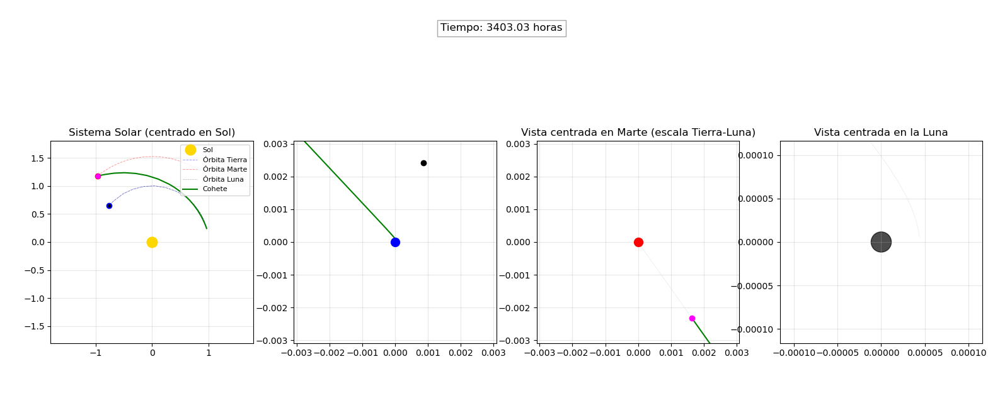

# Interplanetary Trajectory Optimization: Earth to Mars Transfer
### Multi-Body Astrodynamics via Hybrid Fortran 95 / Python Genetic Algorithm & Runge-Kutta 4

[](https://fortran-lang.org/)
[](https://www.python.org/)
[](https://numpy.org/)
[](LICENSE)
[]()

---

## Overview

This project simulates and optimizes interplanetary space trajectories from **Earth to Mars** within a **restricted multi-body gravitational system** (Sun, Earth, Moon, and Mars). 

Calculating optimal transfer trajectories in realistic celestial mechanics is an analytically intractable problem ($N \ge 3$) characterized by highly non-linear, multi-modal search landscapes with chaotic gravitational perturbations. Standard gradient-based optimization often gets trapped in local extrema or diverges.

To solve this, this repository implements a **hybrid computational architecture**:
1. **High-Performance Numerical Core (Fortran 95)**: Propagates the spacecraft equations of motion using a 4th-order Runge-Kutta (**RK4**) integrator in dimensionless astronomical coordinates.
2. **Evolutionary Optimization Engine (Python / `multiprocessing`)**: Employs **Genetic Algorithms (GA)** to search the multi-dimensional parameter space (launch epoch, injection angles, burn impulses $\Delta \vec{v}$, and transfer times) to minimize fuel consumption while ensuring orbital rendezvous and capture around Mars.
3. **F2PY Binding**: Interoperability between Fortran and Python enables compiled C-level execution speed inside a flexible distributed Python optimization loop.

---

## Trajectory Highlights

| Earth Departure & Lunar Influence | Mars Orbital Insertion & Capture |
| :---: | :---: |
|  |  |

| Interplanetary Transfer Arc | Generation vs. Fitness Evolution |
| :---: | :---: |
|  |  |

> 🎬 **Animated Trajectory**: Check out the rendered MP4 visualization in [`trayectoria_animacion.mp4`](trayectoria_animacion.mp4).

---

## Theoretical Foundations

### 1. Dimensionless Equations of Motion
To avoid numerical underflow and severe floating-point roundoff errors over astronomical scales, the system is non-dimensionalized:
- **Unit of length**: Astronomical Unit ($L = 1\text{ AU} \approx 1.496 \times 10^{11}\text{ m}$)
- **Total system mass**: $M_{\mathrm{total}} = M_\odot + M_\oplus + M_{\mathrm{Moon}} + M_{\mathrm{Mars}}$
- **Characteristic time**:
  $$\tau = \sqrt{\frac{L^3}{G M_{\mathrm{total}}}}$$

Under this transformation, the gravitational parameter normalizes to $\mu_{\mathrm{total}} = 1$. The non-dimensionalized acceleration acting on the spacecraft $\vec{r} = (x, y)$ due to body $i$ at position $\vec{r}_i(t)$ with mass ratio $\mu_i = M_i / M_{\mathrm{total}}$ is:

$$\ddot{\vec{r}} = -\sum_{i} \mu_i \frac{\vec{r} - \vec{r}_i(t)}{\|\vec{r} - \vec{r}_i(t)\|^3}$$

### 2. Numerical Integration: Runge-Kutta 4 (RK4)
The second-order equations of motion are cast into a first-order state-space vector $\vec{Y}(t) = [x, y, v_x, v_y]^T$:

$$\frac{d\vec{Y}}{dt} = \vec{f}(t, \vec{Y})$$

The state is updated over time step $h$ via RK4:
$$\begin{aligned}
\vec{k}_1 &= h \, \vec{f}(t_n, \vec{Y}_n) \\
\vec{k}_2 &= h \, \vec{f}(t_n + \tfrac{h}{2}, \vec{Y}_n + \tfrac{\vec{k}_1}{2}) \\
\vec{k}_3 &= h \, \vec{f}(t_n + \tfrac{h}{2}, \vec{Y}_n + \tfrac{\vec{k}_2}{2}) \\
\vec{k}_4 &= h \, \vec{f}(t_n + h, \vec{Y}_n + \vec{k}_3) \\
\vec{Y}_{n+1} &= \vec{Y}_n + \frac{1}{6}(\vec{k}_1 + 2\vec{k}_2 + 2\vec{k}_3 + \vec{k}_4)
\end{aligned}$$

At each sub-step, planetary ephemerides $\vec{r}_i(t)$ are updated synchronously to ensure high-order consistency.

### 3. Genetic Algorithm (GA) Formulation
Candidate trajectories are parameterized by a chromosome:
$$\mathbf{C} = \left[\, \theta_0,\; v_0,\; \Delta v_1,\; \phi_1,\; t_{\mathrm{burn}},\; \Delta v_2,\; \dots \,\right]$$

- **Objective / Fitness Function**:
  $$\mathcal{F} = \frac{1}{1 + \alpha \, d_{\mathrm{min}}(\text{Mars}) + \beta \, \Delta v_{\mathrm{total}} + \gamma \, \Delta v_{\mathrm{capture}}}$$
  where:
  - $d_{\mathrm{min}}(\text{Mars})$ is the closest approach distance to Mars.
  - $\Delta v_{\mathrm{total}}$ is the total propellant consumption.
  - $\Delta v_{\mathrm{capture}}$ accounts for the velocity match requirement relative to Mars's orbital speed.
  - $\alpha, \beta, \gamma$ are scaling hyperparameters.

- **Evolutionary Operators**:
  - Population size: $N \in [500, 2000]$ individuals across up to $1000$ generations.
  - Tournament selection with elitism preservation.
  - Uniform / arithmetic crossover with Gaussian creep mutation.

---

## Repository Structure

```
.
├── src/                        # Numerical and optimization source code
│   ├── marte.f95               # Standalone Fortran 95 simulation program
│   ├── simulacion.f95          # Modular trajectory simulation kernel
│   ├── simulacion2.f95         # Optimized module formatted for F2PY wrapping
│   ├── optimizacion.f95        # Fortran native genetic algorithm routines
│   └── randomnumber.f95        # Uniform and Gaussian PRNG routines
├── optimizacion.py             # Python Genetic Algorithm runner (baseline)
├── optimizacion4.py            # High-performance parallel multi-parameter GA
├── plot_evolucion.py           # Generation convergence & fitness plotting
├── representar_mejor_orbita.py # Trajectory renderer for best-fit solutions
├── grafTray.py                 # Multi-body trajectory visualization toolkit
├── graficas/                   # High-resolution simulation and orbital figures
├── img/                        # Coordinate frame snapshots across GA generations
├── evolucion/                  # Benchmark CSVs tracking population fitness history
├── mejor/                      # Coordinate files for optimal transfer trajectories
├── trayectoria_animacion.mp4   # Rendered animation of the Earth-Mars transfer
├── docs/                       # Theoretical slides & assignment monograph
│   ├── Problema4-cohete-SLIDES.pdf
│   └── problema_enunciado.png
├── Makefile                    # Build scripts for Fortran binaries & F2PY modules
├── requirements.txt            # Python dependencies
└── LICENSE                     # MIT License
```

---

## Quickstart & Execution

### 1. Prerequisites
- **Fortran Compiler**: `gfortran` (GCC) with Fortran 95 support.
- **Python**: Version 3.10 or higher.

Install Python dependencies:
```bash
pip install -r requirements.txt
```

### 2. Build the Fortran Core
Compile the standalone trajectory simulation:
```bash
make
./marte
```

### 3. Compile Python C-Extension (F2PY)
To enable fast trajectory propagation inside Python:
```bash
make f2py
```
This compiles `simulacion2.f95` into a high-speed Python module `simulacion2.so`.

### 4. Run the Genetic Optimizer
```bash
python3 optimizacion4.py
```
To visualize the evolutionary convergence and resulting trajectory:
```bash
python3 plot_evolucion.py
python3 representar_mejor_orbita.py
```

---

## Results & Physical Observations

1. **Gravitational Slingshot & Perturbations**: The optimizer naturally leverages the Moon's gravitational assistance during the geocentric escape phase to minimize the required trans-Mars injection $\Delta v$.
2. **Convergence Characteristics**: Starting from random velocities, the population converges within 100-200 generations toward Hohmann-like transfer trajectories with localized arrival corrections.
3. **Capture Conditions**: Hyperbolic excess velocity at Mars arrival is reduced to allow insertion into a stable Martian parking orbit with minimal final retro-burn.

---

## Author & License

Developed by **[Pablo Orellana Chornyak](https://github.com/porellanaphysics)**  
- 🎓 *M.Sc. Student in Space Science and Technology*, Universidad de Alcalá (UAH, Alcalá de Henares).  
- 🎓 *B.Sc. in Physics (Graduado en Física)*, Universidad de Granada (UGR).  
- 📬 **Email**: [pablo.orellana.physics@gmail.com](mailto:pablo.orellana.physics@gmail.com) | **LinkedIn**: [linkedin.com/in/p-orellana](https://linkedin.com/in/p-orellana)  

Licensed under the [MIT License](LICENSE).
